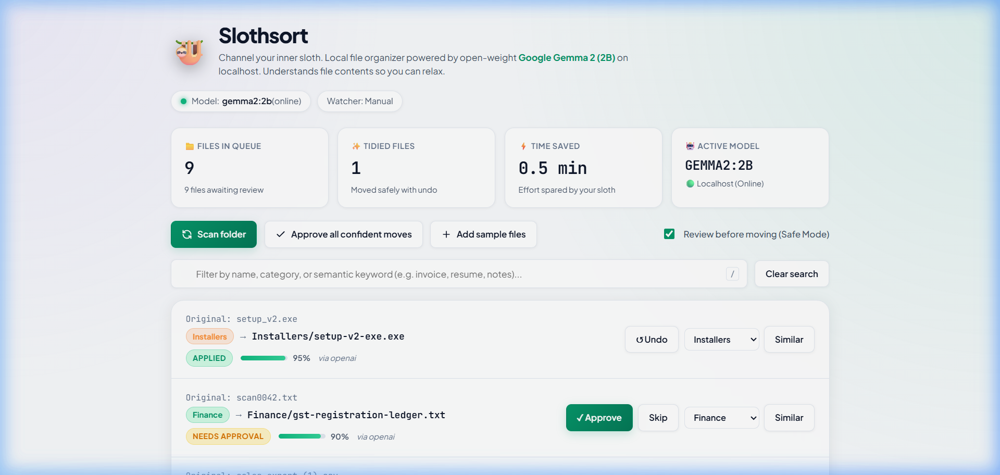
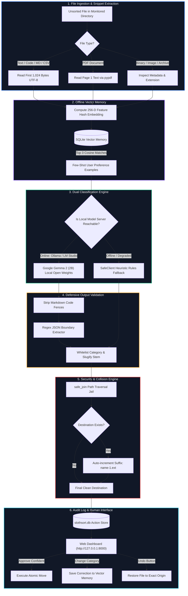
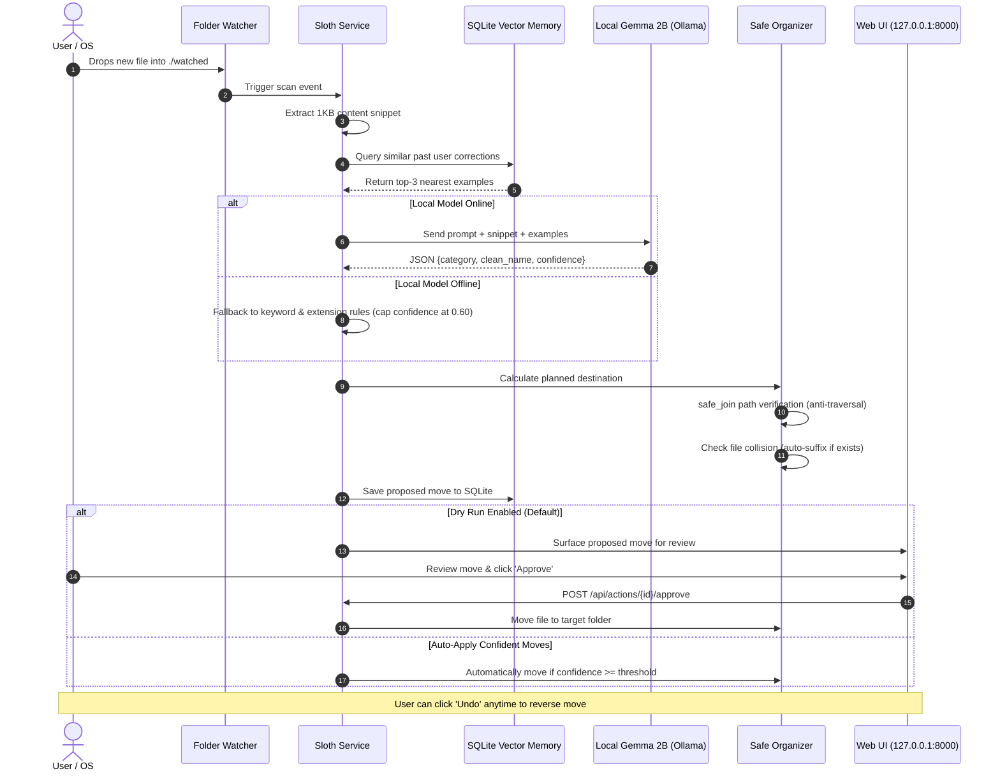
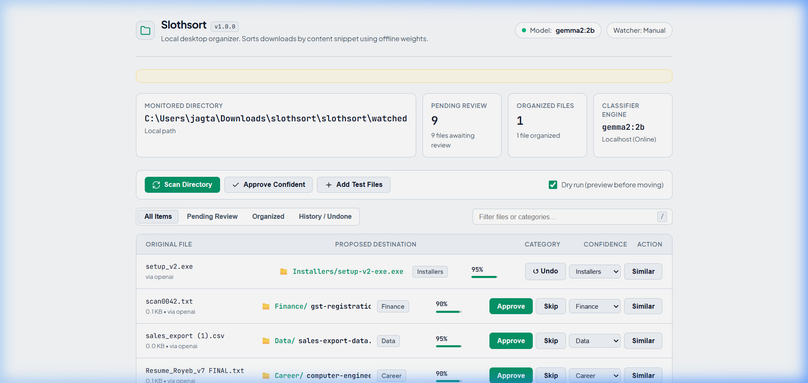
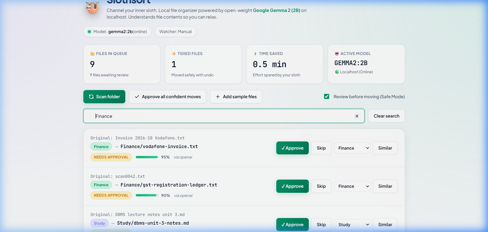

# 🦥 Slothsort

> **Local-first desktop organizer powered by open-weight Gemma models.**  
> Automatically inspects file snippets, sorts messy downloads into clean categories, and suggests descriptive filenames—completely offline with zero data leaks.

[](LICENSE)
[](https://www.python.org/)
[-7c3aed.svg)](https://ai.google.dev/gemma)
[](tests/)
[](DEV_SUBMISSION.md)

---



---

## 📖 Table of Contents
- [The Problem](#-the-problem)
- [Why Slothsort?](#-why-slothsort)
- [System Architecture](#-system-architecture)
- [File Processing Flowchart](#-file-processing-flowchart)
- [Key Features](#-key-features)
- [Real Benchmark: Heuristics vs. Gemma 2B](#-real-benchmark-heuristics-vs-gemma-2b)
- [Quick Start](#-quick-start)
- [Model Backends](#-model-backends)
- [Repository Layout](#-repository-layout)
- [REST API Reference](#-rest-api-reference)
- [Safety & Privacy Guarantees](#-safety--privacy-guarantees)
- [Running Tests](#-running-tests)
- [License](#-license)

---

## 🎯 The Problem

Everyone's `~/Downloads` directory eventually degenerates into a chaotic landfill. Files arrive with useless or machine-generated names:

- `scan0042.txt` (a quarterly business tax ledger)
- `doc1.txt` (a software engineering cover letter)
- `thing.md` (operating systems CPU scheduling notes)
- `Resume_Royeb_v7 FINAL.txt` (an updated resume)
- Miscellaneous invoices, bank statements, logs, and datasets.

Traditional shell scripts and folder rules only inspect **file extensions**. But in real life, a tax statement, an airline ticket, a lease agreement, and a college syllabus are all `.pdf`. Moving all `.pdf` files into a `PDFs/` folder doesn't organize anything—it just moves the clutter into a subdirectory.

Uploading personal financial forms, medical bills, and identity documents to a third-party cloud API is an unacceptable privacy hazard. **Slothsort solves this by running open-weight models locally on localhost.**

---

## 🦥 Why Slothsort?

Built for the **DEV "Slow and Steady" Challenge** (celebrating International Sloth Day), Slothsort channels the inner sloth:

- **Slow and steady wins**: On a standard laptop CPU (without a dedicated GPU), running local inference on Google's quantized `gemma2:2b` takes ~13 seconds per file. Slothsort doesn't try to win a millisecond regex race. It acts patiently in the background, carefully reviewing each file.
- **100% Offline & Air-Gapped**: Personal files never leave your machine (`127.0.0.1`). Zero telemetry, zero token bills, zero third-party logging.
- **Cautious by default**: Slothsort defaults to a **dry-run preview**. It stages proposed moves for human review. It never overwrites, never deletes, and logs every move to an SQLite database with single-click undo.

---

## 🏗️ System Architecture

The following diagram illustrates how raw files flow through snippet extraction, memory retrieval, local model inference, defensive validation, and safe disk placement:



---

## 🔄 File Processing Flowchart

This decision flowchart outlines the execution path of every monitored file from detection to final placement:



---

## 🌟 Key Features

| Feature | Description |
|:---|:---|
| **Local Open Weights** | Powered by Google's **Gemma 2 (2B)** running on your own machine through Ollama or LM Studio. |
| **Snippet-Aware Sorting** | Reads the first 1 KB of text or page 1 of PDFs. Categorizes by what the document actually discusses, not just its extension. |
| **Descriptive Renaming** | Converts opaque names (`scan0042.txt`) into clean, hyphenated stems (`Finance/gst-registration-ledger.txt`). |
| **Interactive Feedback Memory** | Correcting a category in the UI computes an offline 256-D feature hash in SQLite. Future files learn from your habits without model fine-tuning. |
| **Jailed Security (`safe_join`)** | Verifies that all resolved destinations remain strictly inside the watched folder. Prevents path traversal vulnerabilities (`../../`). |
| **Collision Defense** | Never overwrites existing files. Automatically suffixes colliding filenames (`invoice-1.pdf`). |
| **Full Undo Log** | Every move is tracked in a local SQLite database (`slothsort.db`). Click "Undo" to restore any file to its origin. |
| **Resilient Fallback** | If the local model is offline, Slothsort seamlessly drops to deterministic keyword rules so scans never fail. |
| **Fast Keyboard Navigation** | Press `/` to focus instant search filtering and `Escape` to clear. |

---

## 📸 Visual Tour

| Hero Dashboard & Stats | AI Content-Classified Proposals |
|:---:|:---:|
|  |  |

| Instant Search Filtering (`/` shortcut) | Safe Execution & One-Click Undo |
|:---:|:---:|
|  |  |

---

## 📊 Real Benchmark: Heuristics vs. Gemma 2B

Slothsort includes an automated benchmark suite (`benchmark.py`) with 21 real-world synthetic test cases mixing obvious filenames with deliberately misleading names (e.g., `thing.md` containing CPU scheduling notes, `doc1.txt` containing a cover letter).

Here are the **real measured results**:

| Classifier | Correct / Total | Accuracy | Avg Latency / File | Failures / Errors |
|:---|:---:|:---:|:---:|:---:|
| **Standard Rules (Extensions + Keywords)** | 14 / 21 | 67% | 0 ms | 0 |
| **Gemma 2 2B (Local Open Weights)** | **17 / 21** | **81%** | 13,009 ms | **0** |

### Where the Local Model Outperformed Rules:
- `scan0042.txt`: Rules guessed `Documents`. Gemma read the tax ledger snippet and sorted it to `Finance`.
- `doc1.txt`: Rules guessed `Documents`. Gemma identified the cover letter and sorted it to `Career`.
- `thing.md`: Rules guessed `Documents`. Gemma identified operating systems CPU scheduling and sorted it to `Study`.
- `untitled.txt`: Rules guessed `Documents`. Gemma detected Python functions and sorted it to `Code`.

The 14% accuracy jump demonstrates that semantic content inspection solves edge cases where regex simply cannot succeed.

---

## 🚀 Quick Start

### 1. Prerequisites
- **Python 3.12+**
- **Ollama** or **LM Studio** installed locally

### 2. Pull the Open-Weight Gemma Model
```bash
# Using Ollama (recommended for CPU laptops):
ollama pull gemma2:2b
```

### 3. Clone and Setup Environment
```bash
git clone https://github.com/Anurag-tech22/slothsort-.git
cd slothsort-

# Create virtual environment
python -m venv .venv
source .venv/bin/activate       # On Windows: .\.venv\Scripts\activate

# Install dependencies
pip install -r requirements-dev.txt

# Configure environment
cp .env.example .env
```

### 4. Start the Application
```bash
# Linux / macOS:
export LLM_BACKEND=openai
export LLM_BASE_URL=http://127.0.0.1:11434/v1
export DEMO_MODE=true
uvicorn app.main:factory --factory --reload --port 8000

# Windows PowerShell:
$env:LLM_BACKEND="openai"
$env:LLM_BASE_URL="http://127.0.0.1:11434/v1"
$env:DEMO_MODE="true"
.\.venv\Scripts\python.exe -m uvicorn app.main:factory --factory --reload --port 8000
```

Open **[http://127.0.0.1:8000](http://127.0.0.1:8000)** in your browser. Click **Add Test Files**, then click **Scan Directory**.

---

## 🔌 Model Backends

Slothsort supports multiple interchangeable inference providers:

| Backend | `LLM_BACKEND` | Configuration | Network Access |
|:---|:---:|:---|:---:|
| **Ollama / LM Studio / vLLM** | `openai` | Point `LLM_BASE_URL` to local server (`http://127.0.0.1:11434/v1`). Auto-detects loaded model. | **Localhost Only** |
| **In-Process GGUF** | `llamacpp` | Install `requirements-optional.txt`, set `GGUF_PATH=/path/to/model.gguf`. | **Zero Network** |
| **Heuristic Rules** | `heuristic` | No model required. Uses extension and keyword rules. | **Zero Network** |
| **Google Cloud API** | `gemini` | Cloud demo fallback (`GOOGLE_API_KEY`). Only permitted when `DEMO_MODE=true` to prevent leaking real files. | Public API (Demo only) |

---

## ☁️ Deploying on Render (Free Cloud Demo)

You can deploy a live web demo of Slothsort on [Render](https://render.com) in 2 minutes:

### 1-Click Blueprint Deployment:
1. Log in to your [Render Dashboard](https://dashboard.render.com/).
2. Click **New +** → **Blueprint**.
3. Connect your repository: `https://github.com/Anurag-tech22/slothsort-`
4. Render will automatically detect `render.yaml`.
5. Click **Apply**:
   - By default, it runs in `DEMO_MODE=true` with `LLM_BACKEND=heuristic` (works instantly out of the box with zero external API keys!).
   - **Optional**: To use Gemma via Google AI Studio in the cloud demo, set `LLM_BACKEND=gemini` and enter your free `GOOGLE_API_KEY`.
6. Once built, Render will generate a live URL (e.g. `https://slothsort.onrender.com`) for your demo.

---

## 📂 Repository Layout

```
slothsort/
├── .github/
│   └── workflows/
│       └── ci.yml             # Automated GitHub Actions test runner
├── app/
│   ├── static/
│   │   └── index.html         # Handcrafted desktop organizer UI
│   ├── config.py              # Strict environment configuration & validation
│   ├── embed.py               # 256-D offline hashing embedding function
│   ├── llm.py                 # Multi-backend LLM clients & defensive JSON parser
│   ├── main.py                # FastAPI endpoints & lifecycle management
│   ├── organizer.py           # safe_join path jail & atomic move/undo operations
│   ├── service.py             # Business logic, background watcher & memory
│   └── store.py               # SQLite action persistence & vector similarity
├── docs/
│   └── screenshots/           # High-resolution dashboard screenshots
├── tests/
│   └── test_sloth.py          # 36 pytest test cases (paths, collisions, parser)
├── benchmark.py               # Comparative benchmark harness (Rules vs Gemma)
├── benchmark_results.md       # Measured evaluation report
├── DEV_SUBMISSION.md          # Official DEV "Slow and Steady" contest article
├── Dockerfile                 # Containerized deployment build
├── render.yaml                # Render Blueprint deployment definition
├── requirements.txt           # Core production dependencies
├── requirements-dev.txt       # Testing dependencies (pytest, httpx)
├── LICENSE                    # MIT Open Source License
└── README.md                  # Project documentation
```

---

## 🌐 REST API Reference

The FastAPI service exposes a REST API consumed by both the dashboard and CLI scripts:

| Method | Endpoint | Description |
|:---|:---|:---|
| `GET` | `/api/health` | Healthcheck endpoint (`{"ok": true}`). |
| `GET` | `/api/state` | Returns monitored directory, model status, watcher state, and stats. |
| `POST` | `/api/scan` | Scans watched folder for unindexed files and generates proposals. |
| `GET` | `/api/actions` | Lists actions. Filterable by status (`proposed`, `applied`, `undone`, `skipped`). |
| `POST` | `/api/actions/apply-confident` | Automatically executes all pending moves with confidence above threshold. |
| `POST` | `/api/actions/{id}/approve` | Approves and executes a specific pending move. |
| `POST` | `/api/actions/{id}/skip` | Dismisses a pending file move proposal. |
| `POST` | `/api/actions/{id}/undo` | Atomically reverts an applied move back to original path. |
| `POST` | `/api/actions/{id}/correct` | Updates file category and indexes feedback in vector memory. |
| `GET` | `/api/actions/{id}/similar` | Finds past sorted files matching this file's vector embedding. |
| `GET` | `/api/search?q={query}` | Hybrid keyword and semantic vector search across processed files. |
| `POST` | `/api/demo/seed` | Populates sample test files when `DEMO_MODE=true`. |

---

## 🔒 Safety & Privacy Guarantees

1. **Strict Path Jailing**: All file operations pass through `safe_join(root, target)`. Any target that escapes `root.resolve()` throws an `UnsafePathError` and is rejected.
2. **Zero Overwriting**: If `Finance/tax-ledger.txt` exists, Slothsort saves as `Finance/tax-ledger-1.txt`. Files are never destroyed.
3. **No Deletion API**: Slothsort only moves files. There is no `os.remove` or delete endpoint in the codebase.
4. **Air-Gapped Privacy**: Personal documents are read only on device. The SQLite database stores only filenames, categories, confidence scores, and numerical feature vectors—never document bodies.

---

## 🧪 Running Tests

Slothsort maintains a test suite covering path-traversal prevention, canned model hallucinations, collision handling, and SQLite rollback:

```bash
# Run pytest with concise reporting
python -m pytest -q
```

Expected output:
```
36 passed, 1 skipped in 15.96s
```
*(1 skipped on Windows if symlink creation is restricted to elevated accounts; 37 passed on Linux/macOS).*

---

## 📄 License

This project is licensed under the **MIT License** — see the [LICENSE](LICENSE) file for details.

Developed with ❤️ by [Anurag Thopate (Anurag-tech22)](https://github.com/Anurag-tech22) for the DEV "Slow and Steady" Challenge.
